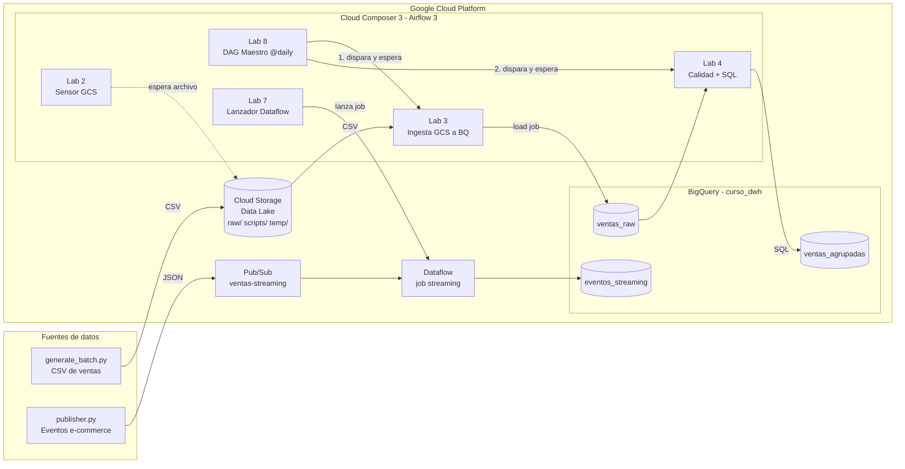
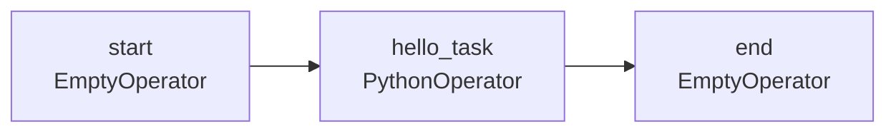
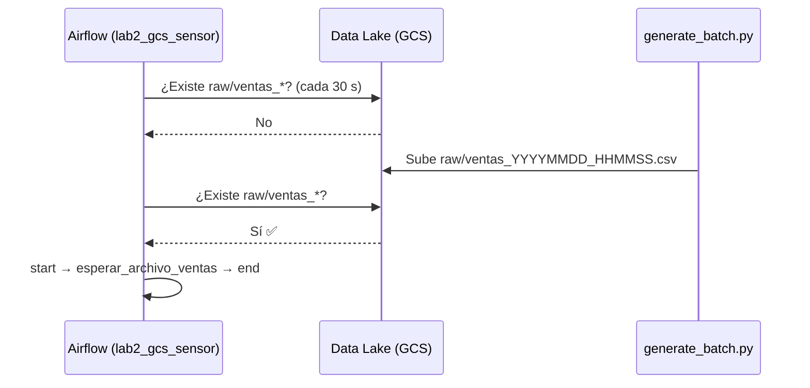
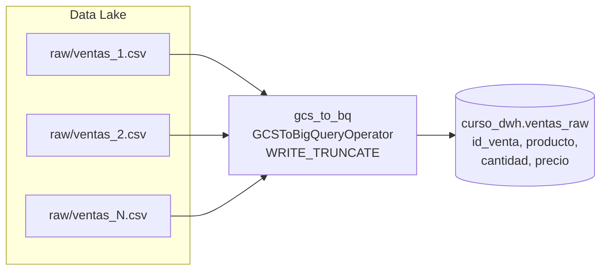
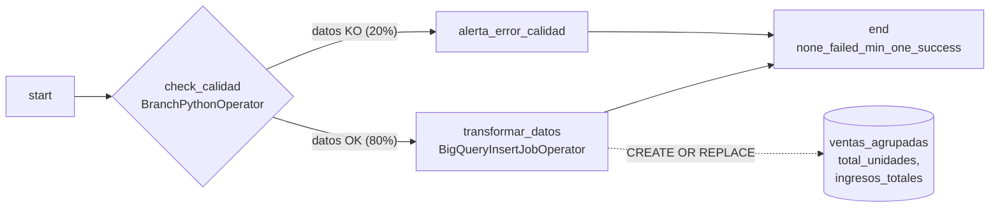
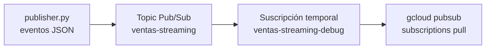
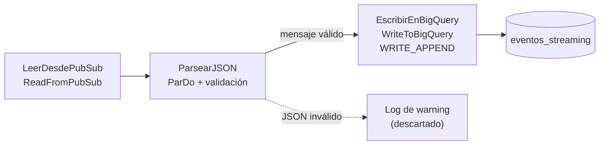
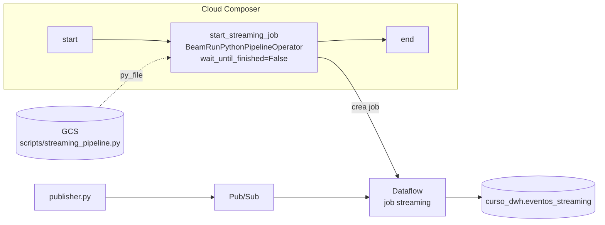
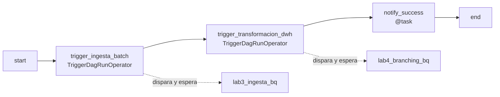

# Orquestación de Pipelines de Datos en GCP con Cloud Composer (Airflow 3)


Plataforma de datos **end-to-end** en Google Cloud que combina procesamiento **batch** y **streaming**, orquestada con **Cloud Composer 3 (Apache Airflow 3)** y con la infraestructura definida en **Terraform**.

A lo largo de 8 laboratorios progresivos se construye lo que haría un equipo de Data Engineering real: un Data Lake en Cloud Storage, un Data Warehouse en BigQuery, ingesta por eventos, controles de calidad, un pipeline en tiempo real con Pub/Sub + Dataflow y un DAG maestro que encadena la ingesta y la transformación batch.

---

## Lo que demuestra este proyecto

| Competencia | Cómo se aplica |
|---|---|
| **Infraestructura como Código** | Terraform crea APIs, IAM, bucket, dataset, topic y el entorno de Composer de forma reproducible |
| **Orquestación** | DAGs en Airflow 3 con `airflow.sdk`, TaskFlow API, sensores, branching y DAGs maestros |
| **Ingeniería de datos batch** | Ingesta GCS → BigQuery con esquema explícito y cargas idempotentes (`WRITE_TRUNCATE`) |
| **Streaming** | Pipeline Apache Beam en Dataflow que lee de Pub/Sub y escribe en BigQuery en tiempo real |
| **Calidad de datos** | Control de calidad (simulado) con ramificación condicional y descarte de mensajes corruptos en streaming |
| **Seguridad** | Cuenta de servicio dedicada con roles de mínimo privilegio, sin claves ni secretos en el repo |
| **FinOps** | Entorno `SMALL`, script de limpieza y gestión explícita de jobs streaming para evitar costes |

---

## Arquitectura general



> **Terraform** aprovisiona el entorno de Composer, el bucket, el dataset de BigQuery, el topic de Pub/Sub, las APIs y los permisos IAM. El **job de Dataflow no** se crea con Terraform: lo lanza Airflow en el Lab 7 cuando se ejecuta el DAG. El Lab 1 (*Hello World*) solo valida el entorno y no participa en el flujo de datos.

### Flujo batch vs. streaming

- **Batch (Labs 2, 3, 4 y 8):** el Lab 2 genera los CSV y demuestra cómo esperar su llegada con un sensor. El Lab 3 los carga en `ventas_raw` y el Lab 4 aplica el control de calidad y crea `ventas_agrupadas`. El **DAG maestro (Lab 8) encadena solo los Labs 3 y 4** una vez al día.
- **Streaming (Labs 5, 6 y 7):** eventos JSON → Pub/Sub → Dataflow (Beam) → `eventos_streaming`. Airflow solo **lanza** el job; Dataflow lo mantiene vivo de forma continua.

---

## Stack tecnológico

- **Cloud Composer 3** (`composer-3-airflow-3.1.7`): Airflow gestionado
- **Cloud Storage**: Data Lake (zona `raw/`, scripts y temporales)
- **BigQuery**: Data Warehouse
- **Pub/Sub**: mensajería en tiempo real
- **Dataflow + Apache Beam**: procesamiento streaming
- **Terraform** (provider `google ~> 8.2`): infraestructura como código
- **Python**: DAGs, generadores de datos y pipeline Beam

---

## Estructura del repositorio

```
.
├── terraform/
│   ├── main.tf                     # APIs, IAM, GCS, BigQuery, Pub/Sub y Composer
│   └── terraform.tfvars.example    # Plantilla de variables
├── dags/                           # DAGs de Airflow (uno por laboratorio)
│   ├── lab1_hello_world.py
│   ├── lab2_sensor_gcs.py
│   ├── lab3_gcs_to_bq.py
│   ├── lab4_branching.py
│   ├── lab7_dataflow_streaming.py
│   └── lab8_master_dag.py
├── scripts/
│   ├── env.sh                      # Configuración común de los scripts labN.sh
│   ├── data_generators/generate_batch.py   # Genera CSVs de ventas y los sube a GCS
│   ├── streaming/publisher.py      # Simula eventos de e-commerce en Pub/Sub
│   └── beam/streaming_pipeline.py  # Pipeline Apache Beam (Pub/Sub → BigQuery)
├── config.env.example              # Plantilla: PROJECT_ID, REGION, COMPOSER_ENV
├── setup.sh                        # Lab 0: autenticación, APIs y entorno Python
├── lab1.sh … lab8.sh               # Un script por laboratorio
├── cleanup.sh                      # Elimina todos los recursos
├── requirements.txt                # Dependencias de los scripts locales
└── requirements-beam.txt           # (Opcional) Beam para pruebas en local
```

---

## Puesta en marcha

### Requisitos previos

- Un proyecto de Google Cloud con **facturación activada** y rol **Owner** (o Editor + Project IAM Admin).
- [Google Cloud CLI](https://cloud.google.com/sdk/docs/install), [Terraform ≥ 1.5](https://developer.hashicorp.com/terraform/install) y Python 3.10+.
- Terminal Bash: Linux, macOS, **WSL** en Windows o directamente **Cloud Shell** (ya trae todo instalado).
- La red VPC `default` debe existir en el proyecto (Dataflow la usa en el Lab 7).

### Paso 0: Configuración y despliegue

```bash
git clone https://github.com/Dgelviz2688/gcp-cloud-composer.git
cd gcp-cloud-composer

# 1. Configura tu proyecto (un único sitio para PROJECT_ID, REGION y nombre del entorno)
cp config.env.example config.env
cp terraform/terraform.tfvars.example terraform/terraform.tfvars
# ✏️ Edita ambos archivos con tu PROJECT_ID

# 2. Autenticación, APIs y entorno virtual de Python
./setup.sh

# 3. Despliega la infraestructura (la creación de Composer tarda ~25-40 min)
cd terraform
terraform init
terraform apply
terraform output airflow_uri   # URL de la interfaz web de Airflow
cd ..
```

> **¿Por qué no hay que crear variables de Airflow a mano?** Terraform las inyecta en Composer como variables de entorno `AIRFLOW_VAR_PROJECT_ID`, `AIRFLOW_VAR_REGION` y `AIRFLOW_VAR_DATAFLOW_SA`. Los DAGs las leen con `{{ var.value.project_id }}`, sin escribir el ID del proyecto en el código.

---

## Laboratorios

### Lab 1: Hello World en Cloud Composer

**Objetivo:** comprobar que el entorno funciona y entender la estructura básica de un DAG.

Un DAG (*Directed Acyclic Graph*) es el "plano" de un flujo de trabajo: define **qué** tareas existen y en **qué orden** se ejecutan. Este primer DAG encadena dos marcadores (`EmptyOperator`) con una tarea Python.



**Conceptos:** `DAG`, `start_date`, `schedule=None` (ejecución manual), `catchup=False`, dependencias con `>>`.

```bash
./lab1.sh
```

**Validación:** en la UI de Airflow lanza `lab1_hello_world` ▶️ y revisa en los logs de `hello_task` el mensaje *"¡Hola Cloud Composer!"*.

---

### Lab 2: Sensor de Cloud Storage (orquestación por eventos)

**Objetivo:** hacer que un pipeline **espere** a que lleguen datos en lugar de ejecutarse a ciegas.

El `GCSObjectsWithPrefixExistenceSensor` revisa el Data Lake cada 30 s buscando archivos `raw/ventas_*`. Cuando el generador sube un CSV, el sensor se libera y el DAG continúa. Si en 10 minutos no llega nada, el DAG falla.



**Conceptos:** sensores, `poke_interval`, `timeout`, Jinja templating (`{{ var.value.project_id }}`).

```bash
./lab2.sh   # Sube el DAG, espera a que lo lances y genera 100 ventas simuladas en CSV
```

**Validación:** la tarea `esperar_archivo_ventas` pasa de *running* a *success* en cuanto aparece el archivo.

---

### Lab 3: Ingesta de Cloud Storage a BigQuery

**Objetivo:** cargar los CSV del Data Lake en el Data Warehouse.

`GCSToBigQueryOperator` lanza un **load job** nativo de BigQuery (sin pasar los datos por Airflow), con esquema explícito y `WRITE_TRUNCATE`: cada ejecución recarga todos los CSV, así que el resultado es **idempotente** (ejecutarlo dos veces no duplica datos).



**Conceptos:** operadores de transferencia, esquemas de BigQuery, cargas completas vs. incrementales, ubicación de jobs (`location`).

```bash
./lab3.sh
```

**Validación:**
```sql
SELECT COUNT(*) FROM `TU_PROJECT_ID.curso_dwh.ventas_raw`;  -- 100 filas por cada CSV generado
```

---

### Lab 4: Branching y control de calidad de datos

**Objetivo:** tomar decisiones dentro del pipeline según la calidad de los datos.

> **Requisito:** la tabla `ventas_raw` debe existir (ejecuta antes el Lab 3).

`BranchPythonOperator` **simula** un control de calidad con un resultado aleatorio (80% OK / 20% KO). En un caso real esta función consultaría nulos o duplicados en BigQuery. Si los datos son válidos, se ejecuta una transformación SQL en BigQuery que agrega las ventas por producto. Si no, se sigue el camino de alerta. La tarea final usa la *trigger rule* `none_failed_min_one_success` para continuar sea cual sea la rama elegida.



**Conceptos:** ramificación, *trigger rules*, tareas *skipped*, transformaciones ELT con SQL.

```bash
./lab4.sh
```

**Validación:** ejecuta el DAG varias veces y observa en la vista *Graph* cómo cambia la rama. Consulta `curso_dwh.ventas_agrupadas`.

---

### Lab 5: Simulador de eventos en tiempo real con Pub/Sub

**Objetivo:** generar un flujo continuo de eventos que alimentará el pipeline streaming.

`publisher.py` simula la actividad de una tienda online publicando eventos JSON (`view_item` 70%, `add_to_cart` 20%, `purchase` 10%) cada 0,5-2 s. `lab5.sh` crea una suscripción temporal, publica eventos durante 15 s, lee algunos para comprobar que llegan y borra la suscripción al terminar.



Ejemplo de evento:
```json
{"usuario": "user_4821", "producto": "Monitor 4K", "accion": "add_to_cart", "timestamp": 1760000000}
```

```bash
./lab5.sh
```

**Validación:** la terminal muestra los eventos publicados y los mensajes leídos desde la suscripción.

---

### Lab 6: Pipeline de Apache Beam para streaming

**Objetivo:** escribir el pipeline que procesará los eventos en tiempo real y publicarlo en el Data Lake.

El pipeline (`scripts/beam/streaming_pipeline.py`) tiene tres pasos: **leer** de Pub/Sub, **parsear y validar** el JSON (los mensajes corruptos se registran y se descartan para que no bloqueen el streaming) y **escribir** en BigQuery en modo `WRITE_APPEND`, creando la tabla si no existe.



```bash
./lab6.sh   # Sube el pipeline a gs://<PROJECT_ID>-data-lake/scripts/
```

**Conceptos:** `PCollection`, `ParDo`, modo streaming, despliegue de código en GCS.

---

### Lab 7: Orquestar Dataflow streaming desde Airflow

**Objetivo:** que Airflow lance el job de Dataflow sin quedarse bloqueado esperando (un job streaming no termina nunca).

`BeamRunPythonPipelineOperator` descarga el pipeline desde GCS y lo lanza con `DataflowRunner`. Con `wait_until_finished=False`, la tarea termina en cuanto Dataflow acepta el job, y este sigue corriendo en segundo plano. Los workers usan la cuenta de servicio dedicada creada por Terraform.

> 💡 En Airflow 3 / Composer 3 el antiguo `DataflowCreatePythonJobOperator` ya no existe; este laboratorio usa su sustituto oficial del provider de Apache Beam.



```bash
./lab7.sh
# 1. Lanza 'lab7_dataflow_orchestration' en Airflow
# 2. Cuando el job esté "Running" en Dataflow (~3-5 min), genera tráfico:
.venv/bin/python scripts/streaming/publisher.py TU_PROJECT_ID
```

**Validación:**
```sql
SELECT accion, COUNT(*) AS eventos
FROM `TU_PROJECT_ID.curso_dwh.eventos_streaming`
GROUP BY accion;
```

> ⚠️ **Importante:** un job streaming cobra mientras está activo. Al terminar, detenlo:
> ```bash
> gcloud dataflow jobs list --region europe-southwest1 --status active
> gcloud dataflow jobs drain JOB_ID --region europe-southwest1
> ```
> Si lanzas el DAG dos veces se crearán **dos** jobs en paralelo.

---

### Lab 8: DAG maestro (patrón *controller*)

**Objetivo:** encadenar la ingesta y la transformación batch desde un único DAG programado.

El DAG maestro se ejecuta cada día (`@daily`) y dispara **solo dos DAGs**, en orden: la ingesta (`lab3_ingesta_bq`, Lab 3) y la transformación (`lab4_branching_bq`, Lab 4). Usa `TriggerDagRunOperator` y **espera** a que cada uno termine antes de seguir. Al final notifica el resultado con una tarea `@task` (TaskFlow API). Así cada DAG sigue siendo pequeño y reutilizable, y la secuencia se define en un único sitio.

> **Requisitos:** los DAGs de los Labs 3 y 4 ya subidos y al menos un CSV en `raw/` (generado en el Lab 2). El sensor del Lab 2 **no** forma parte del maestro.



```bash
./lab8.sh   # Sube el DAG y activa (unpause) los DAGs de los Labs 3 y 4
```

> Los DAGs disparados deben estar **activos**. Si están en pausa, el maestro se quedaría esperando indefinidamente. `lab8.sh` los activa automáticamente.

**Validación:** lanza `lab8_master_controller` ▶️ (o actívalo para que se ejecute cada día). En la vista *Grid* verás cómo crea ejecuciones de `lab3_ingesta_bq` y `lab4_branching_bq`.

> Como el control de calidad del Lab 4 termina en éxito por cualquiera de sus dos ramas, el maestro también termina en éxito aunque se haya tomado la rama de alerta.

---

## Decisiones técnicas

- **Una sola fuente de configuración:** `config.env` para los scripts y `terraform.tfvars` para la infraestructura. Ningún ID de proyecto está escrito en el código.
- **Variables de Airflow como variables de entorno** (`AIRFLOW_VAR_*`) inyectadas por Terraform: no hay pasos manuales y el entorno se puede reproducir.
- **Mínimo privilegio:** una cuenta de servicio dedicada (`composer-curso-sa`) con solo los roles necesarios, en lugar de la cuenta de servicio de Compute por defecto con rol Editor.
- **Airflow 3 nativo:** imports desde `airflow.sdk` y `airflow.providers.standard`, sin APIs obsoletas.
- **ELT sobre BigQuery:** los datos se cargan en crudo y se transforman con SQL dentro del Data Warehouse. Airflow orquesta pero no mueve datos.
- **Streaming resiliente:** los mensajes malformados se descartan con un log en lugar de bloquear el pipeline con reintentos infinitos.

## Costes y limpieza

Cloud Composer y Dataflow generan costes mientras están activos. Al terminar los laboratorios:

```bash
./cleanup.sh   # Drena los jobs de Dataflow activos y ejecuta terraform destroy
```

Composer no elimina su bucket interno (`<region>-composer-curso-…-bucket`); bórralo manualmente desde la consola si ya no lo necesitas.

## Solución de problemas

| Síntoma | Causa probable / Solución |
|---|---|
| `terraform apply` falla en `composer_agent` | El agente de servicio de Composer aún no existe. Espera 1-2 minutos y repite `terraform apply` |
| El DAG no aparece en la UI | Composer tarda 1-3 min en procesar un DAG nuevo. Revisa *DAG Import Errors* |
| El sensor del Lab 2 falla por timeout | No se generó ningún CSV en 10 min. Ejecuta de nuevo `generate_batch.py` |
| Lab 3 falla con "Not found: raw/*.csv" | Primero genera datos con el Lab 2 |
| El job de Dataflow falla con "network default" | El proyecto no tiene VPC `default`. Créala o pasa `network`/`subnetwork` en `pipeline_options` |
| No llegan filas a `eventos_streaming` | Arranca `publisher.py` **después** de que el job esté *Running*: Pub/Sub no guarda los mensajes publicados antes de que exista la suscripción |

---

## Autora

**Diana Gelviz**: Data Engineer · Google Cloud
[GitHub](https://github.com/Dgelviz2688)
